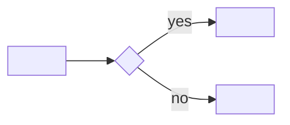

# NNNN. <Decision as a short statement, e.g. "Weight 0 pins an entry">
<!-- Immutable once Accepted: to change the decision, write a new ADR that supersedes this one and only update the
     status line here. Style: short statements, one idea per bullet, conclusion first; flows and states as diagrams,
     trade-offs as tables. No paragraph longer than 3 lines. -->

- Decision log: #<row>   <!-- omit this line when the project has no decision log (WORKFLOW.md "Decision log") -->

## Decision
- <the choice, in one line>
- <its scope or limit, in one line>

## Context
- <one fact or constraint per bullet> (`Class.method`)
- <why decide now>

## Options
| Option | For | Against |
|---|---|---|
| **A (chosen)**: <one-line option> | <…> | <…> |
| B: <one-line option, incl. rejected alternatives> | <…> | <…> |

## How it works
<!-- Only when the decision shapes a flow, a state machine or a structure; otherwise delete this section. -->

## Consequences
- ✅ <what gets easier>
- ⚠️ <cost or risk accepted>
- ↩️ <how to reverse>

## Guardrails
<!-- What must not regress, as "Don't …" rules with the code that enforces or depends on them. -->
- Don't <…> (`file` / test `<name>`)
