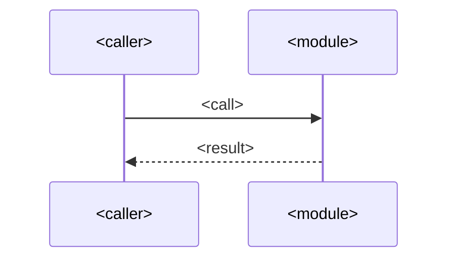

# <Module name>
<!-- Living doc, C4 level 3. Keep the 9 section numbers and names in every module: write `n/a` instead of deleting a
     section; add module-specific sections after 9. The code is the source of truth: link generated references
     instead of copying them; unknown intent → TODO(<owner>), never invented. -->

## 1. Purpose
<What this module is responsible for, and what it is explicitly not responsible for.>

## 2. Public interface
<Entry points other modules or clients use. Link the generated spec/Javadoc; list only the main types or endpoints
with one line each.>

## 3. Dependencies
<Modules and external systems it uses, and who uses it.>

## 4. Data
<Data this module owns or persists: stores, schemas, formats. `n/a` for stateless modules.>

## 5. Key flows
<!-- 2–4 flows. Per flow: a `###` title, one line on its purpose, numbered steps (one action each, code reference at
     the end), and a diagram. No prose paragraphs. -->
### <Flow name>
<One line: what this flow achieves.>
1. <action> (`Class.method`)
2. <action>

## 6. Invariants and gotchas
<!-- One bullet per rule: the rule in one line, then "— why" in a few words, then the code reference. -->
- **<rule>** — <why> (`Class.method`)

## 7. Code map
<Where to start reading: the main files/classes and what each does. This is the bridge from docs to code.>
- `<path/to/File>` — <role>

## 8. Decisions
- [ADR-NNNN](../../adr/NNNN-<slug>.md) — <title>

## 9. History
<!-- One line per sync that changed this doc: date · summary · ADR/plan links. Newest first. -->
- YYYY-MM-DD · 
 · <ADR-NNNN / plan>
