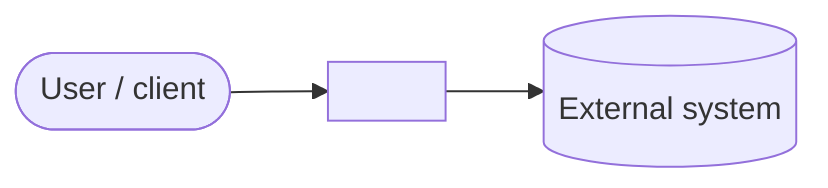
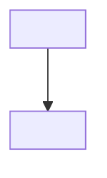

# Overview
<!-- System-level living doc: a trimmed arc42 with C4 levels 1–2. Explain intent and structure; link down to module
     docs for detail. Every behavior claim comes from code read during init/sync; unknown intent → TODO(<owner>). -->

## 1. Goals and context
<What the system is for, who uses it, the 2–4 quality goals that drive the design (e.g. latency, correctness).>

## 2. Constraints
<Technical, organizational or legal constraints: language/runtime versions, compatibility promises, licenses.>

## 3. Building blocks
<Containers or modules and their responsibilities (C4 level 2). One line each; details live in module docs.>

| Block | Responsibility | Doc |
|---|---|---|
| <module> | <one line> | [modules/<module>](modules/<module>/README.md) |

## 4. Cross-cutting concepts
<Concurrency model, error handling, configuration, logging, security, testing strategy: only what applies.>

## 5. Quality and risks
<Quality requirements with measurable targets where they exist; known risks and technical debt.>

## 6. History
<!-- One line per sync that changed this page: date · summary · ADR/plan links. Newest first. -->
- YYYY-MM-DD · 
 · <ADR-NNNN>
